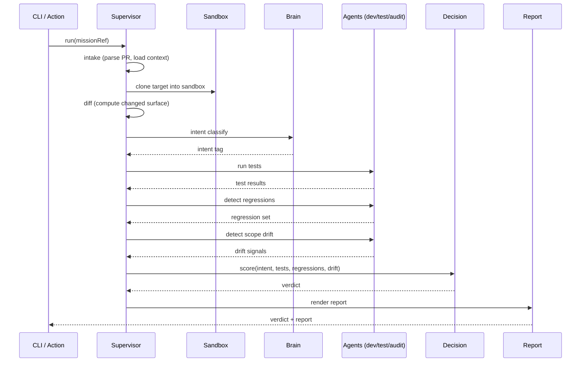

# AI-EMPIRE Architecture

## Why this exists

Code-generation pipelines (Lovable, Codex, Cursor agents, GitHub Copilot Workspace, and similar) produce pull requests at a rate humans cannot meaningfully review one by one. Most of those PRs are fine; some are broken, scope-drifted, or quietly destructive. AI-EMPIRE inserts a **verdict gate** between "AI proposed a change" and "humans merge it" — a deterministic, sandboxed evaluation that returns APPROVE / NEEDS_REVIEW / REJECT with a human-readable report, before anyone has to read the diff.

## Big picture

```
                  +------------------+
                  |   target repo    |
                  | (PR from AI bot) |
                  +--------+---------+
                           |
                           v
              +---------------------------+
              |  CLI  /  GitHub Action    |   <-- surface
              +-------------+-------------+
                            |
                            v
                     +------+------+
                     |   intake    |   parse PR, fetch diff, classify intent
                     +------+------+
                            |
                            v
                  +---------+---------+
                  |  sandbox clone    |   isolated working copy, no write to target
                  +---------+---------+
                            |
                            v
                  +---------+---------+
                  |       brain       |   plan generation (legacy V3)
                  +---------+---------+
                            |
              +-------------+-------------+
              |             |             |
              v             v             v
         +--------+    +--------+    +---------+
         |  dev   |    |  test  |    |  audit  |   agents
         +---+----+    +---+----+    +----+----+
             |             |              |
             +------+------+------+-------+
                    |             |
                    v             v
              +-----+----+   +----+-----+
              | decision |   |   git    |
              +-----+----+   +----+-----+
                    |
                    v
        +-----------+-----------+
        |  verdict + report     |   APPROVE / NEEDS_REVIEW / REJECT
        +-----------------------+
```

## Layers

- **CLI** (`src/cli/`) — surface only, delegates to supervisor. No business logic lives here.
- **Supervisor** (`src/supervisor/`) — orchestrates one mission end-to-end: intake → sandbox → brain → agents → decision → report.
- **Brain** (`src/brain/`) — plan generation (legacy from V3, still used). Produces the per-mission plan consumed by agents.
- **Agents** (`src/agents/`) — dev/test/audit/git (legacy from V3, still used). Each agent owns one concern; none of them write to the target branch.
- **Core** (`src/core/`) — RiskGate, SandboxManager, logger, audit logger. Cross-cutting safety and observability primitives.
- **Integrations** (`src/integrations/`) — GitHub Action wrapper today; adapter slots for future CI / VCS / chat surfaces.
- **LLM** (`src/llm/`) — provider-agnostic interface. OpenAI today; swappable without touching callers.
- **Lib** (`src/lib/`) — paths, schemas, report, logger. Pure utilities shared across layers.

## Mission lifecycle



## Data model

The schemas for missions, verdicts, agent outputs, and report payloads are defined in [`specs/001-public-release-v1/data-model.md`](../specs/001-public-release-v1/data-model.md). That file is the source of truth; this document only describes their flow.

## Safety model

See [`SECURITY.md`](../SECURITY.md) for the full safety model. In short:

- **Sandbox** — every mission runs inside an isolated clone managed by `SandboxManager`. The agents operate on that clone, never on the user's working tree or the target branch.
- **RiskGate** — `src/core/RiskGate` classifies actions and blocks high-risk operations (network, destructive FS ops, unbounded shell) before they reach the LLM-driven layers.
- **No write to target branch** — by construction, AI-EMPIRE produces a verdict and a report. It does not push, merge, or rewrite history on the target repository.

## Where to extend

New surfaces (CI providers, VCS hosts, chat triggers) and new model providers plug in through the adapter pattern. See [`docs/adapters.md`](./adapters.md) for the contract, the existing integrations, and a checklist for adding a new one.
